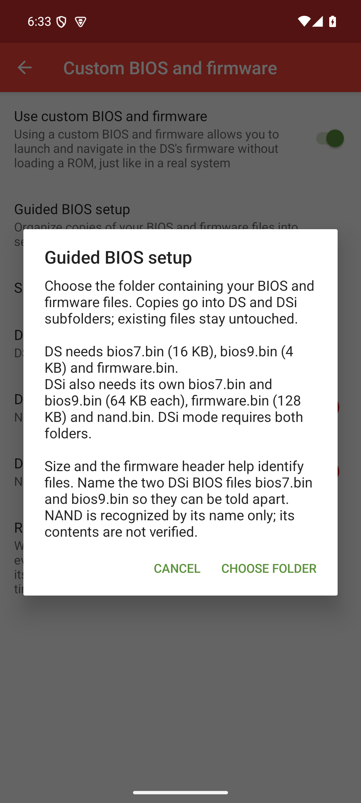
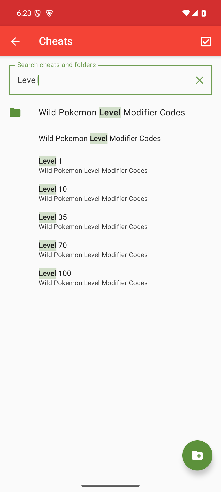
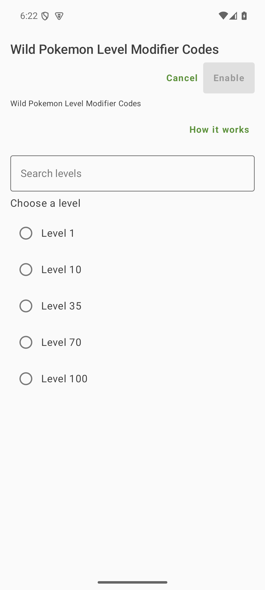
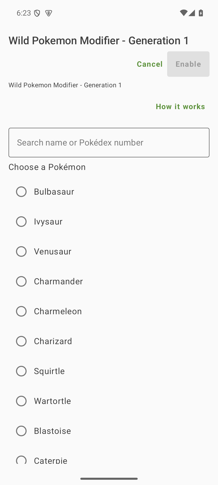
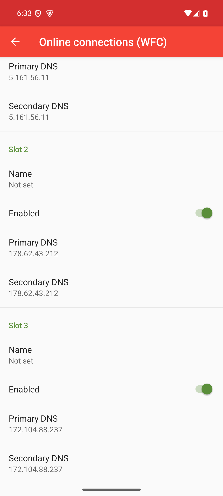

# melonDS Android UD Nightly

UD Nightly is a fork of [melonDS Android](https://github.com/rafaelvcaetano/melonDS-android), the Android port of the [melonDS](https://melonds.kuribo64.net/) Nintendo DS and DSi emulator. It adds easier setup and controls, and includes fixes for saves, imports, Android lifecycle handling and the native core.

[Downloads and release notes](https://github.com/Umberto-DEV/melonDS-android/releases) · [Feature and update guide](docs/user-guide/UD-NIGHTLY.md) · [Android core fork](https://github.com/Umberto-DEV/melonDS-android-lib)

Check each release for its exact version, Android package, CPU architectures, signing certificate and test results. An older release does not establish that the latest source has been packaged or tested on your device.

[Historical UD Nightly 2.1.8 downloads](https://github.com/Umberto-DEV/melonDS-android/releases/tag/ud-nightly-2.1.8) include the APK, complete source archive, checked source patches and checksums. See the [release verification](docs/maintenance/2026-11-04-ud-nightly/README.md).

**UD Nightly 2.1.10/51** adds selective removal of library entries. Check the [2.1.10 release page](https://github.com/Umberto-DEV/melonDS-android/releases/tag/ud-nightly-2.1.10) for availability, artifacts and the release manifest. Its public-package APK has passed a 49→51 update and bounded API 35 ARM64/16 KiB checks; the compatible legacy APK has passed a 50→51 update and selective cleanup on the AYN Thor. The [candidate identity and validation](docs/maintenance/2026-11-06-library-entry-removal/README.md#android-candidate-acceptance) record 355 JVM/API tests, zero lint errors and 479 warnings, plus the exact library, file-preservation and copied-save coverage. The [earlier 2.1.9 legacy-package delivery](docs/maintenance/2026-11-04-thor-rtc-update/README.md) retains its own identity and limits.

<a id="what-is-new-compared-with-official-nightly"></a>
## What's new

The feature comparison starts from official app `c42995ca` and Android core `431ab4bd`. Current main integrates [Komalis's RTC PR #1664](https://github.com/rafaelvcaetano/melonDS-android/pull/1664) at `fa214944`. On 6 November 2026, official app master was newer (`feab12e5`): its later archive, update-installer and workflow changes are not yet integrated here. The published 2.1.8 downloads keep their original source identities. [RTC integration and tests](docs/maintenance/2026-11-04-upstream-alignment/README.md)

- **Guided BIOS and firmware setup.** Select a folder, see separate DS/DSi results and retry a failed copy before adopting its files. UD implementation; existing firmware requirements still apply. [Setup details](docs/user-guide/UD-NIGHTLY.md#bios-and-firmware-setup) · [Implementation](https://github.com/Umberto-DEV/melonDS-android/commit/db986311)
- **Firmware Wi-Fi controls.** Edit three connection slots, names and DNS settings; enable or disable slots from the pause menu. UD implementation; successful configuration does not establish game/server connectivity. [Connection settings](docs/user-guide/UD-NIGHTLY.md#online-connection-settings) · [Implementation](https://github.com/Umberto-DEV/melonDS-android/commit/0b5810e1)
- **Cheat search and grouped choices.** Search names, folders, codes and selector options without enabling a result. Supported families provide species, level, nature and starter choices. Search adapts and extends [takanuva15's #1677](https://github.com/rafaelvcaetano/melonDS-android/pull/1677); grouped selectors are UD work. The supported Sacred Gold Plus profile retains its in-game L+R encounter toggle; compatibility depends on the exact ROM/code set. DAT support already existed upstream. [Cheat guide](docs/user-guide/UD-NIGHTLY.md#cheat-search-and-import) · [Selector scope and UI checks](docs/maintenance/2026-10-28-refinement/INTEGRATION-REPORT.md#1-funzioni-aggiunte-nellapp)
- **Settings and layout backup access.** Expose the existing upstream backup manager, validate restored values and refresh controller settings. This retains the original implementation and addresses the access requested in [#264](https://github.com/rafaelvcaetano/melonDS-android/issues/264). [Backup and restore](docs/user-guide/UD-NIGHTLY.md#settings-and-controls)
- **Remove one library entry.** The ROM details page can forget a selected entry and its per-game settings/history while keeping ROMs, saves, cheats and other entries. The confirmation identifies its exact URI. A file still present can be rediscovered by a later scan. New for 2.1.10/51; selected-entry removal and cold persistence passed on the named ARM64 emulator and Thor candidates. [Behavior, regression tests and limits](docs/maintenance/2026-11-06-library-entry-removal/README.md)
- **Combination hotkeys and hold to fast-forward.** Adapt [WailAbou's #1606](https://github.com/rafaelvcaetano/melonDS-android/pull/1606) and [#1608](https://github.com/rafaelvcaetano/melonDS-android/pull/1608), with interrupted-input controls. Optional fast-forward mute adapts [dysprosium's #1625](https://github.com/rafaelvcaetano/melonDS-android/pull/1625); it is a listening option, not an audio-fidelity fix. [Controls](docs/user-guide/UD-NIGHTLY.md#settings-and-controls)
- **External launches and sleep/lid handling.** Adapt [N3MI-DG's #1648](https://github.com/rafaelvcaetano/melonDS-android/pull/1648) and [DLCSharp's #1589](https://github.com/rafaelvcaetano/melonDS-android/pull/1589), with selected lifecycle fixes from [corigne's #1666](https://github.com/rafaelvcaetano/melonDS-android/pull/1666). Complete recovery after process death is not claimed. [Adaptation scope](docs/maintenance/2026-10-28-refinement/INTEGRATION-REPORT.md#4-issue-e-pr-cosa-è-chiuso-davvero)
- **Optional forward-only clock correction.** Resume synchronization is now upstream via Benjamin BONVARLET/Komalis's [#1664](https://github.com/rafaelvcaetano/melonDS-android/pull/1664). UD retains its existing default-off setting and only advances a clock that is at least 30 seconds behind. [Policy and limits](docs/maintenance/2026-11-04-upstream-alignment/README.md#existing-fork-behavior-and-resolution)

DS/DSi emulation, OpenGL/Compute rendering, high-resolution 3D, DAT import and the underlying backup manager retain their upstream authorship. The [core overview](https://github.com/Umberto-DEV/melonDS-android-lib#whats-new) describes the optional hostname-override API and shared-core changes; the firmware Wi-Fi editor does not call that API.

## Screenshots

These are actual UD Nightly 2.1.8 screens on an Android 15 emulator, using synthetic data. The cheat examples remain disabled. [Capture identity and checksums](docs/images/ud-nightly/provenance.json)

| Guided BIOS setup | Cheat search | Level selector |
| --- | --- | --- |
|  |  |  |

| Species selector | Firmware connection slots |
| --- | --- |
|  |  |

## Bug fixes

Each dossier records the affected path, before/after behavior, source identity, tests and limits. **High/Medium/Low** below reproduce the linked security record's rating; other impact labels describe functional consequences without assigning a security score. Historical test results apply to their named candidates, not every later build.

| Correction | Impact | Evidence and remaining limits |
| --- | --- | --- |
| Keep pending save writes after an I/O failure; report failure and permit retry. | Progress loss risk | [SaveManager/file-mode tests and raw-save checks](docs/maintenance/2026-10-28-refinement/INTEGRATION-REPORT.md#2-correzioni-app-difetto-prima-e-dopo). Some SAF fallback providers can still truncate; this is not universal atomic replacement. |
| Preserve the previous cheat database during failed/cancelled XML or DAT import; read fragmented input completely and stop at invalid offsets/EOF. | Database loss, hang | [C1/C2 before/after and JVM/ART/SQLite checks](docs/maintenance/2026-10-28-android-bugfixes/REPORT.md#cosa-abbiamo-corretto-adesso). Provider cancellation has the documented cooperation limits. |
| Reject incomplete BIOS/TMD files and clean up failed NAND imports before adopting them. | Invalid data adoption | [N1/N2 reproductions](docs/maintenance/2026-10-28-android-bugfixes/REPORT.md#cosa-abbiamo-corretto-adesso) and [setup lifecycle/SAF checks](docs/maintenance/2026-10-28-refinement/INTEGRATION-REPORT.md#2-correzioni-app-difetto-prima-e-dopo). DSi HOME and logical quota remain separate. |
| Saturate amplified microphone samples and keep capture cursors with their owning buffers; serialize source/session changes. | Distorted input, crash | [A1/A2 numeric and lifecycle controls](docs/maintenance/2026-10-28-android-bugfixes/REPORT.md#cosa-abbiamo-corretto-adesso), [concurrency evidence](docs/maintenance/2026-10-28-refinement/INTEGRATION-REPORT.md#2-correzioni-app-difetto-prima-e-dopo). Physical microphone sensitivity and Bluetooth are not certified. |
| Release interrupted touches/controller state, update stationary multi-touch coordinates and restore both DS screens after display disconnect. | Stuck input, missing display | [D1/I1 JVM/Android regressions](docs/maintenance/2026-10-28-android-bugfixes/REPORT.md#cosa-abbiamo-corretto-adesso). New casting controls, hardware display behavior and input latency are not established. |
| Handle failed audio opens/resume, renderer fallback and session teardown with explicit ownership. | Crash, silent or blank output | [Lifecycle/renderer controls](docs/maintenance/2026-10-28-refinement/INTEGRATION-REPORT.md#2-correzioni-app-difetto-prima-e-dopo). Component/AVD evidence does not close every driver-specific resume report. |
| Serialize scans, persist the newly selected sort order, load icons independently and bound 7z heap use/archive traversal. | Crash, blocked library, wrong ordering | [Library/archive/sort controls](docs/maintenance/2026-10-28-refinement/INTEGRATION-REPORT.md#2-correzioni-app-difetto-prima-e-dopo). Oversized archives may need manual extraction; later upstream #1524 changes are not yet integrated. |
| Remove a selected obsolete ROM entry without resetting the library; serialize removal with scanning and persist the retained entries atomically. | Stale entries, missing selective cleanup | [Library-entry dossier](docs/maintenance/2026-11-06-library-entry-removal/README.md): three initial RED failures plus two invalidation regressions; 16 focused and 355 full JVM/API tests passed. Exact-candidate updates, native UI removal and cold persistence passed within the recorded emulator/Thor coverage; provider faults and power-loss durability remain unproven. |
| Keep selector actions visible with large text and the keyboard; use option-specific labels and a single radio action. | Clipped or misleading controls | [UI regressions/captures](docs/maintenance/2026-10-28-refinement/INTEGRATION-REPORT.md#1-funzioni-aggiunte-nellapp) · [Final release selector labels](docs/maintenance/2026-11-04-ud-nightly/README.md). These correct fork-added UI; spoken TalkBack and physical gamepad acceptance remain separate. |
| Check ROM sizes, cache destinations and derived save names before access. | Medium: storage exhaustion or file overwrite | [Cache-size case](docs/maintenance/2026-11-03-security-followup/FINDING-DETAILS.md#occ_9423bc5a581f219396ba5434) · [Save-name case](docs/maintenance/2026-11-03-security-followup/FINDING-DETAILS.md#occ_198b7bfed24d33a6f5a9703a). Per-case source/regression evidence does not certify every provider. |
| Accept granted external-launch URIs instead of trusting serialized ROM authority; reject malformed/null launch fields. | High: unintended file access; Low: launch crash | [Authority boundary](docs/maintenance/2026-11-03-security-followup/FINDING-DETAILS.md#occ_0ead515f26677112d1f828d6) · [Malformed launch](docs/maintenance/2026-11-03-security-followup/FINDING-DETAILS.md#occ_a58108db986cc45682121731). Scoped-storage restrictions still apply. |
| Disable unauthenticated DSiWare metadata sources by default and require the validated transport/size contract. | Medium: untrusted metadata adoption | [Transport correction and proof](docs/maintenance/2026-11-03-security-followup/FINDING-DETAILS.md#occ_7912862fc50149068674e372). This does not authenticate arbitrary title content or provide a production metadata service. |
| Bound imported cheat data and validate restored settings/firmware before adopting them. | Medium/Low: allocation or startup failure; High at the firmware/native boundary | [Cheat allocation](docs/maintenance/2026-11-03-security-followup/FINDING-DETAILS.md#occ_bc26e0f9273443d666f51fd1) · [Settings](docs/maintenance/2026-11-03-security-followup/FINDING-DETAILS.md#occ_1211210d24906e23b17d51f2) · [Firmware](docs/maintenance/2026-11-03-security-followup/FINDING-DETAILS.md#occ_3b5415742d7ddbfad77786f5). Dynamic evidence varies by card. |
| Validate savestate length and state invariants, restoring the previous state when load fails. | Medium/High: allocation, partial state or native memory access | [Length](docs/maintenance/2026-11-03-security-followup/FINDING-DETAILS.md#occ_4ab7c23e479f23f205e15b1f) · [Rollback](docs/maintenance/2026-11-03-security-followup/FINDING-DETAILS.md#occ_277d6d22695d3f279a0df1f1) · [Invariants](docs/maintenance/2026-11-03-security-followup/FINDING-DETAILS.md#occ_54a7deb0ad08a3fafebc1726). Old savestate/game compatibility remains bounded to the tested inputs. |
| Release JNI references/string leases and retain NAND enumeration ownership; handle provider write exceptions. | Medium/Low: resource exhaustion, lifetime or failed save retry | [JNI](docs/maintenance/2026-11-03-security-followup/FINDING-DETAILS.md#occ_a28be96fd4601332ade34084) · [NAND lifetime](docs/maintenance/2026-11-03-security-followup/FINDING-DETAILS.md#occ_95f95be3047a6de20473771d) · [Save exceptions](docs/maintenance/2026-11-03-security-followup/FINDING-DETAILS.md#occ_b8800026c2c1514ac6cf77e3). Tests retain their ART/component distinctions. |
| Keep RetroAchievements credentials out of URL logs/platform backup; bound responses and close retry resources. | Medium/Low: credential exposure or resource exhaustion | [Logging](docs/maintenance/2026-11-03-security-followup/FINDING-DETAILS.md#occ_f39613af9fae3c25d83a0055) · [Backup](docs/maintenance/2026-11-03-security-followup/FINDING-DETAILS.md#occ_6cb1c55ef7aff5b4986102aa) · [Responses](docs/maintenance/2026-11-03-security-followup/FINDING-DETAILS.md#occ_f49486b60787daa20317b351). These do not fix game-specific achievement rules. |
| Preserve the native DS pixel grid for LCD/scanline filters and stop dispatching resume for a stopped session. | Visual error, invalid lifecycle callback | [Filter changes](docs/maintenance/2026-10-28-refinement/INTEGRATION-REPORT.md#2-correzioni-app-difetto-prima-e-dopo) · [Eight resume RED/GREEN cases](docs/maintenance/2026-11-04-upstream-alignment/README.md#verification). The latter postdates public 2.1.8. |
| Pin CI dependencies and restrict signing/publication to the intended repository/event. | Low: release dependency integrity | [Repository correction](docs/maintenance/2026-11-03-security-followup/FINDING-DETAILS.md#occ_dec38863aa79dfd2f944a501). External release-environment/tag controls remain unverified. |
| Recover failed NAND save replacement; correct JIT ownership/literals, cartridge/peripheral bounds and cheat work limits. | Data integrity, native memory safety, hang | [Shared-core bug dossiers](https://github.com/Umberto-DEV/melonDS-android-lib#bug-fixes), with separate host/Android evidence and compatibility limits. |

The [complete finding index](docs/maintenance/2026-11-03-security-followup/FINDING-DETAILS.md#index) contains 35 + 66 **occurrences**, not 101 independent bugs. The register records 97 occurrences with code corrections, two with repository corrections but unverified external controls, one Android-not-applicable case and one informational reconciliation. A source correction, an individually reproduced failure and a passing aggregate suite are different evidence levels.

The [issue and PR coverage register](docs/maintenance/2026-10-28-refinement/ISSUE-PR-COVERAGE.csv) distinguishes complete local fixes, partial coverage and work not integrated. A fix in this fork does not close an upstream issue or merge another contributor's PR.

## Install or update

Use the APK listed in a release and verify its SHA-256 checksum before installing. Commercial game images, personal BIOS/firmware, NAND and game saves are not included. The source retains the upstream freely redistributable BIOS replacement and its license.

- **New UD installation:** use the standalone UD Nightly APK and select your own game and system files.
- **Existing UD installation:** an in-place update requires the same Android package and signing certificate, with a higher version code. Back up saves, settings, layouts, cheats and system files first. Keep the app installed; do not clear its data as an update step.
- **Official Nightly installation:** UD Nightly follows the `.nightly` package name but has a different signing identity. Android will reject replacing the author's signed APK with a fork-signed APK.
- **Earlier `.nightly.perf` installation:** use its explicitly labeled compatible update. The public `.nightly` APK cannot update it in place. Private databases and saved document permissions do not transfer automatically between package names.

A [source patch](docs/user-guide/SOURCE-PATCHES.md) is for developers applying changes to the documented source revision and rebuilding. It cannot turn the author's signed APK into an update signed by this fork. [Installation and update details](docs/user-guide/UD-NIGHTLY.md#installation-and-data-preservation)

The persistent UD release signing certificate has SHA-256 fingerprint `832a0223e29802245c0e9f8ca24c8358e7d21cfe0dbea347845fda751f950d86`. Verify the downloaded APK against its release manifest. Earlier `.perf` builds use a different preserved local identity and require their separately labeled update.

## Supported behavior and limits

DS/DSi emulation, supported ROM archives and the existing renderers remain available. Local multiplayer, DSi SD-card support, new casting controls and broad device-specific compatibility are not claimed by these changes. Online settings do not guarantee that a game, access point or community server will connect.

Testing includes JVM/API checks, native sanitizers, Android native tests on ARM64 4 KiB and 16 KiB environments, and real-app tests on Android emulators. Physical-device results and skipped checks are recorded separately in the [verification reports](docs/maintenance/README.md). Test success does not certify every game, Android version or device. No measured battery, CPU, GPU, RAM or frame-rate improvement is claimed without a corresponding comparison.

## Building

Both fork repositories use `main`. The app pins the exact core revision as a Git submodule and compiles it into the APK; end users do not install the core separately.

```sh
git clone --recurse-submodules --branch main https://github.com/Umberto-DEV/melonDS-android.git
cd melonds-android
sh ./gradlew :app:assembleGitHubNightlyDebug
```

A plain source ZIP does not contain submodule contents. In an existing checkout, use `git submodule update --init --recursive`; do not use `--remote` when reproducing a pinned build. The debug build has a separate `.dev` ID and is not the release update.

Use Java 21 and the SDK, NDK and CMake versions declared by the project. Release builds use `:app:assembleGitHubNightlyRelease` and require an owner-controlled signing key configured in untracked `local.properties`:

```properties
MELONDS_KEYSTORE=/path/to/keystore
MELONDS_KEYSTORE_PASSWORD=<store password>
MELONDS_KEY_ALIAS=<key alias>
MELONDS_KEY_PASSWORD=<key password>
```

Keep signing material and passwords out of Git, artifacts and logs. Published UD updates must preserve their signing identity.

## Credits and license

Rafael Caetano maintains the upstream Android port; melonDS and its contributors provide the core. This fork preserves their licenses and credits. Adapted app work includes takanuva15 (cheat search), WailAbou (hotkeys and hold to fast-forward), dysprosium (fast-forward mute), N3MI-DG (external launches), DLCSharp (sleep/lid behavior), selected fixes by corigne, and Benjamin BONVARLET/Komalis (RTC PR #1664). The evidence documents retain the corresponding PR links and scope.

See [LICENSE](LICENSE), the [core contributor guide](https://github.com/Umberto-DEV/melonDS-android-lib/blob/main/CONTRIBUTING.md) and the original projects for licensing and contributor information. Game and system files are not distributed here.
